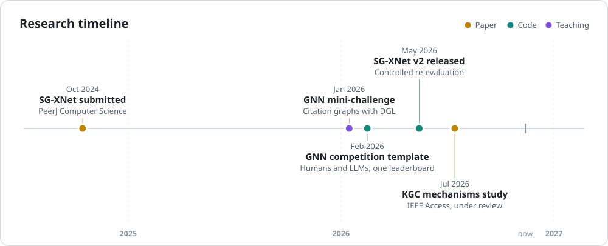
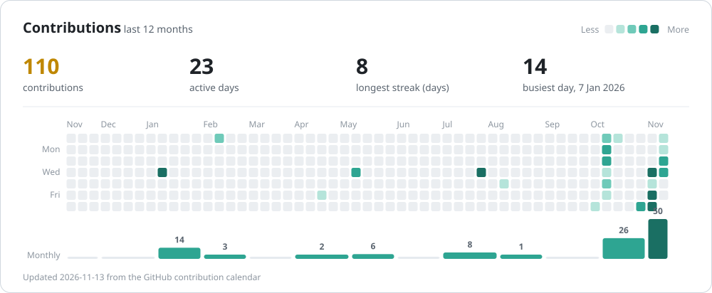
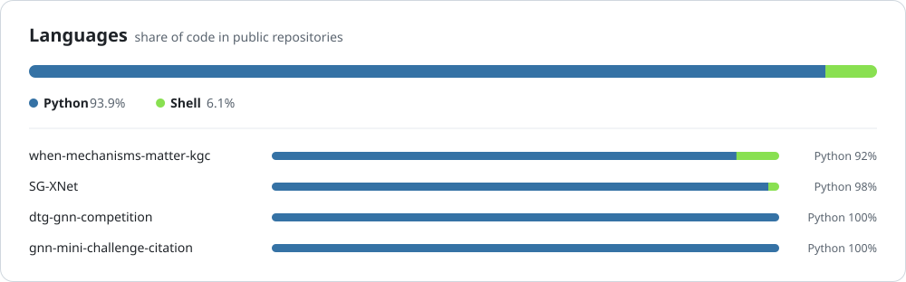

<picture>
  <source media="(prefers-color-scheme: dark)" srcset="assets/banner-dark.svg">
  
</picture>

I work on **graph neural networks, knowledge graphs and language models**, mostly through controlled experiments: one variable at a time, a shared training budget, several seeds, and released result registers, so that every number can be recomputed.

[ORCID](https://orcid.org/0009-0002-0813-740X) · [All repositories](https://github.com/mwasim-research?tab=repositories)

## Selected work

**[When Do Mechanisms Matter in GNN-Based Knowledge Graph Completion?](https://github.com/mwasim-research/when-mechanisms-matter-kgc)** 
M. Wasim, J. Zarrin, S. ElSayed, D. Jayemanne · *IEEE Access*, under review (2026) 
A controlled study of entity–relation composition, message aggregation and symbolic rule delivery in CompGCN-style models. Delivering complete rule bodies during training reaches 0.3565 ± 0.0011 filtered MRR on FB15k-237 over four seeds, and relation cardinality and prediction direction explain more than the choice of mechanism.

**[SG-XNet v2](https://github.com/mwasim-research/SG-XNet)** 
R. Khan, M. Wasim, S. Alahmari, A. Waseem · *PeerJ Computer Science*, submitted 
A controlled re-evaluation of transfer learning for node classification: SG-XNet, a GraphSAGE layer followed by GCN layers, against GCN, GraphSAGE, GAT, GIN and an MLP.

**[GNN competition template](https://github.com/mwasim-research/dtg-gnn-competition)** 
A safe, reproducible competition in which people and LLMs compete on equal terms: participants submit predictions only, and GitHub Actions scores them on a public leaderboard. Includes a diffusion-based (DTG) baseline.

**[GNN mini-challenge: citation graphs](https://github.com/mwasim-research/gnn-mini-challenge-citation)** 
A teaching challenge in semi-supervised node classification on a directed citation graph, with DGL.

<picture>
  <source media="(prefers-color-scheme: dark)" srcset="assets/timeline-dark.svg">
  
</picture>

## Activity

<picture>
  <source media="(prefers-color-scheme: dark)" srcset="assets/activity-dark.svg">
  
</picture>

<picture>
  <source media="(prefers-color-scheme: dark)" srcset="assets/languages-dark.svg">
  
</picture>

<picture>
  <source media="(prefers-color-scheme: dark)" srcset="assets/snake-dark.svg">
  
</picture>

## Toolbox

<picture>
  <source media="(prefers-color-scheme: dark)" srcset="assets/toolbox-dark.svg">
  
</picture>

The cards are redrawn every day by a GitHub Action in this repository. Text, toolbox and timeline: <code>profile.toml</code>.
